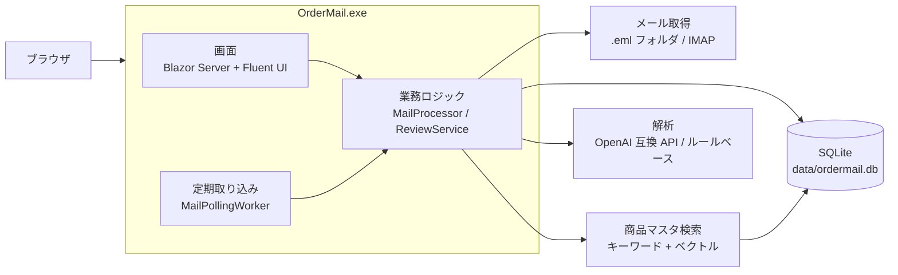
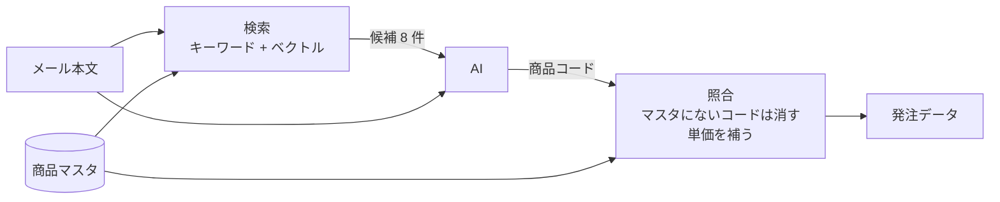

# 発注メール AI 仕分け

受信メールを取り込み、文面がばらばらな発注メールを AI で読み取って発注データに登録する業務アプリです。
AI の判定に自信がないものは「要確認」に回し、担当者がブラウザ画面で確認・修正して確定します。

**ポートフォリオ用のデモアプリです。** 動かすときは [Releases](https://github.com/Shohei-Yamashiro/order-mail-ai/releases) の zip（案内 PDF・利用条件付き）を使うのがおすすめです。ソースはこのリポジトリで公開しています。サポート義務は負いません。配布物の exe には発行元の電子署名がないため、Windows の SmartScreen 警告が出ることがあります。

- **zip を解凍して exe を起動するだけで動作**（インストール不要・.NET 不要・DB サーバー不要）
- **AI は接続設定式**：契約済みの Azure OpenAI / OpenAI / Gemini から、Ollama などのローカル LLM まで、OpenAI 互換 API ならどれでも利用可能（[接続先の例](#接続先の例)）
- **AI なしでも動作**：キーワードと書式パターンによるルールベース判定を内蔵（サンプル 20 通で正解率 100%）
- **商品マスタ照合（RAG）**：本文から自社の商品マスタを検索して候補を AI に渡し、明細に商品コードと標準単価を付ける（[商品マスタ照合](#商品マスタ照合rag)）
- **担当者の修正を改善に活かす**：手本・修正の集計・ファインチューニング用データの書き出し（[フィードバックとチューニング](#フィードバックとチューニング)）

## ライセンス

| 対象 | 内容 |
|---|---|
| **ソースコード**（このリポジトリ） | [MIT License](LICENSE)。改変・再配布可（著作権表示とライセンス文の保持が条件） |
| **配布用 zip**（Releases の実行ファイル一式） | 同梱の `LICENSE.txt`（利用条件）。個人・法人とも無償で利用可。再配布・改変は作者の許諾が必要。無保証 |

外部部品の表記は zip 内の `THIRD-PARTY-NOTICES.txt` を参照してください。脆弱性の報告は [SECURITY.md](SECURITY.md) を参照してください。

## 画面

| 画面 | 内容 |
|---|---|
| 受信メール | 取り込んだメールの一覧。状態（要確認 / 発注 / 発注以外 / 解析失敗）と AI の自信度で絞り込み |
| メール詳細 | 左に本文、右に AI が抽出した発注内容（明細には商品コード）。修正して「発注として登録」または「発注ではない」で確定 |
| 発注一覧 | 登録済みの発注（自動登録か人が確認済みか、金額、希望納期） |
| AI の改善 | 担当者の修正の集計（実運用での項目ごとの正解率）、ファインチューニング用の学習データの書き出し（ローカル LLM 用の学習キット、OpenAI・Azure OpenAI 用の JSONL） |
| 設定 | メールの取得元、AI の接続先（プリセットとテスト解析）、AI への指示（プロンプト）の編集、商品マスタ（取り込み・ベクトル作成・試し検索）、確認済みメールでの評価、自動登録のしきい値 |

## 構成



### 処理の流れ

1. **取り込み**：`.eml` フォルダまたは IMAP から新着メールを取得（`Message-ID` で重複除外、HTML メールはテキスト化）
2. **解析**：AI に JSON スキーマを指定して「発注か」「自信度」「会社名・担当者・希望納期・明細」を抽出（似た確定済みメールと、本文から検索した商品マスタの候補も一緒に渡す）
3. **照合**：明細の商品コードを商品マスタで確かめ、メールに単価がなければマスタの単価を入れる
4. **振り分け**：自信度がしきい値（既定 0.8）以上なら自動で「発注」登録または「発注以外」。未満や明細なしは「要確認」
5. **人の確認**：詳細画面で修正して確定。確定済みのメールは再解析しても判定が上書きされない

### AI 接続の工夫

- 接続先ごとに構造化出力の対応が違うため、`json_schema` → `json_object` → 指定なし の順に自動で切り替え
- `temperature` の指定を受け付けないモデル（推論系のモデルなど）では、指定を外して送り直す
- Azure OpenAI には API キーを `api-key` ヘッダーで、それ以外には `Authorization: Bearer` で送る
- 出力が JSON として読めないときは、エラー内容を伝えて 1 回だけ再生成させる
- 数量が `"50本"` のような文字列、自信度が 0〜100 のような揺れも吸収してから保存
- 解析履歴（どの解析器で、何秒かかり、どう判定したか）をメールごとに保存し、接続先の比較に使える
- **手本**：担当者が確定したメールのうち、差出人が同じものや文面が似ているものを数件、「メールと正しい答え」の会話例として AI に渡す（モデルの再学習は不要で、確定するほど取引先ごとの書き方に合ってくる）
- **相対日付の計算**：「今週土曜」「来週金曜」「明日」などはアプリが受信日から日付に換算して AI に渡し、「来週中」のように日が決まらない表現はそう伝える（小さいローカル LLM は自力の日付計算を誤りやすいため）
- **当社名**：設定した当社名を AI に伝え、それでも会社名に当社名が返ってきたら空欄に戻す（宛名との取り違え対策）

### プロンプトの調整

設定画面の「AI への指示（プロンプト）」で、判定と抽出のルールを書き換えられます。出力形式（JSON のキー）と、当社名・受信日のカレンダーはアプリが自動で付け足すので、ルールを書き換えても解析結果を読み取れなくなることはありません。
「確認済みメールで評価」を押すと、担当者が確定したメールを画面上の設定（保存前でも可）で解析し直し、判定・明細・会社名・納期の一致率と、自動で確定できる割合を前回の結果と並べて表示します。結果は保存されず、メールの状態も変わりません。

### 商品マスタ照合（RAG）

メールの品名は「付箋の黄色」「USB-C charging cable 1m」「KT-200（延長コード 3m）」のように書き方がばらばらです。自社の商品マスタを検索して AI に渡すことで、マスタにある商品コードで明細を登録します（RAG：検索した社内データを AI への入力に加える方式）。



1. **検索**：本文の各行（引用行を除く）で商品マスタを探す。キーワード検索は商品名・別名・品番の文字の一致、ベクトル検索は埋め込みモデルによる意味の近さ。2 つの順位を RRF（Reciprocal Rank Fusion）で合わせる
2. **AI に渡す**：上位の候補（既定 8 件）をメールの後ろに付け、「候補に同じ商品があればそのコード。色・サイズ・容量が違うものは選ばない。なければ null」と指示する。色違い・サイズ違いの似た商品もあえて候補に入れ、AI に選び分けさせる
3. **照合**：AI が返したコードがマスタにあるか確かめ（作り話のコードは消す）、メールに単価・単位がなければマスタの値を入れる。AI を使わないときは、品名が 1 つの商品に決まる場合だけコードを付ける

| 項目 | 内容 |
|---|---|
| 商品マスタ | CSV（列：`code, name, aliases, unit, unit_price`。別名は `\|` 区切り）を設定画面から取り込む。初回起動時はサンプル（`samples/products.csv`、38 件）を自動で取り込む |
| 埋め込みモデル | 任意。チャットと同じ接続先・API キーの `/embeddings` を使う（Azure OpenAI は `text-embedding-3-small` などのデプロイ名、OpenAI は `text-embedding-3-small`、Ollama は `bge-m3` など）。未設定ならキーワード検索のみ |
| ベクトルの保存 | 商品ごとに SQLite に保存（ベクトル DB は使わない）。数千件程度なら全件との比較で十分速い |
| 評価 | 確定した発注に商品コードがあれば、「評価」と「AI の改善」で商品コードの一致率も出す |

- サンプルの発注 11 通・23 明細は、AI なし（ルールベース＋照合）でもすべて正しいコードになります。Ollama（qwen2.5:7b）でも、候補からコードを選べることを実機で確認しています。
- 埋め込み API の呼び出しは、送信内容を自動テストで確認しています（実際の埋め込みモデルでの検索は未確認）。

#### 同じ仕組みで追加できる使い方

「検索して AI に渡し、答えをアプリが確かめる」形は、商品マスタ以外の社内データにも使えます。

| 使い方 | 検索する社内データ | 効果 |
|---|---|---|
| 取引先の特定 | 取引先マスタ（会社名・別名・ドメイン・担当者） | 「㈱みなと」「みなとフーズ」などの表記ゆれを取引先コードにそろえ、締め日・配送先を自動で付ける |
| 「いつもの」の補完 | 同じ取引先の過去の確定発注 | 「いつもの」「前回と同じ数で」といった明細のない発注を、直近の発注から下書きする |
| 取引条件・社内ルールの確認 | 取引条件書・最小ロット・締め時刻・取扱終了品の一覧 | 「最小ロット未満」「取扱終了品」などを要確認の理由として示す |
| 問い合わせへの回答案 | 商品仕様・価格表・在庫 | 見積依頼・在庫確認（発注以外のメール）に、仕様と価格を引用した回答案を作る |
| 受注確認メールの下書き | 確定内容と過去の返信例 | 取引先ごとの書き方に合わせた受注確認の返信を下書きする |

### フィードバックとチューニング

担当者の確定（修正）を、次の 3 段階で AI の改善に使います。

| 段階 | 仕組み | 必要な件数の目安 |
|---|---|---|
| 手本 | 似た確定済みメールを、正しい答えと一緒に毎回 AI に渡す（再学習なし） | 数件から |
| 修正の集計と指示の調整 | 「AI の改善」画面で、担当者が確定した時点の解析結果と確定内容を比べ、どの項目をよく直しているかを解析器ごとに集計する。弱い項目に合わせて「AI への指示」を直し、「評価」で効果を確かめる | 数十件 |
| ファインチューニング | 確定済みメールをチャット形式の JSONL（指示文・メール・確定した答え）に書き出し、モデルを追加学習する。学習したモデルの名前を設定に入れれば、そのまま使える | 数百件 |

書き出したファイルは `data/exports` に保存されます。指示文はアプリが実際に送るものと同じなので、学習時と利用時で入力の形がずれません。書き出し先は 2 通りです。

- **ローカル LLM（Ollama）**：学習データに加えて、学習スクリプト（`train.py`、[Unsloth](https://github.com/unslothai/unsloth) による 4bit の LoRA 学習）、Ollama 登録用の `Modelfile.in`、手順書（`README.md`）を 1 つのフォルダに書き出します。
  - 学習はアプリの外（手元の GPU、VRAM 8GB 程度から）で行います。アプリには Python も GPU も不要のままです。
  - 設定中のモデル（例：`qwen2.5:7b`）から、学習に使う Hugging Face の元のモデル（例：`unsloth/Qwen2.5-7B-Instruct`）を決めます。
  - 学習するのは答えの部分だけです（`train_on_responses_only`）。学習後は GGUF（q4_k_m）に変換します。
  - Modelfile には、Ollama の `/api/show` から取得した元のモデルの会話テンプレートと停止語を引き継ぎます。これで学習時と利用時の会話の形がそろいます。
  - `ollama create ordermail-ft -f Modelfile` で登録し、設定のモデル名を変えて「評価」で元のモデルと比べます。
  - キットの生成とテンプレートの取得は動作を確認済みです。実際の学習は、学習用の環境（Python 3.11／3.12・CUDA）と数百件の確定データがそろってから行う想定です。
- **クラウド（OpenAI・Azure OpenAI）**：各サービスのファインチューニングにそのまま渡せる JSONL を書き出します。

## 使い方

### 配布用 zip から

1. `OrderMail-win-x64.zip` を解凍して `OrderMail.exe` を起動（ブラウザが開きます）
2. 「受信メール」で「取り込み・解析」を押すと、同梱のサンプルメール 20 通を取り込みます

### 接続先の例

設定画面の「AI の接続先」で「OpenAI 互換 API」を選び、プリセットで入力欄を埋めてから、お使いの環境に合わせて書き換えます。

| 接続先 | エンドポイント | モデル | API キー |
|---|---|---|---|
| Azure OpenAI | `https://<リソース名>.openai.azure.com/openai/v1` | Azure で作成した**デプロイ名** | Azure ポータルの「キーとエンドポイント」 |
| OpenAI | `https://api.openai.com/v1` | `gpt-4.1-mini` など | [OpenAI Platform](https://platform.openai.com/) で発行 |
| Gemini | `https://generativelanguage.googleapis.com/v1beta/openai` | `gemini-2.5-flash` など | [Google AI Studio](https://aistudio.google.com/) で発行 |
| Ollama（ローカル） | `http://localhost:11434/v1` | `qwen2.5:7b` など（事前に `ollama pull`） | 不要 |
| LM Studio（ローカル） | `http://localhost:1234/v1` | LM Studio で読み込んだモデル名 | 不要 |

- Azure OpenAI は v1 API（`/openai/v1`）を使うので、`api-version` の指定は不要です。リソースのエンドポイントが `*.cognitiveservices.azure.com` や `*.services.ai.azure.com` の場合も、末尾に `/openai/v1` を付けて指定します。
- 「テスト解析」で、保存前に接続と読み取りを確かめられます。
- 推論系のモデルなど、`temperature` や JSON スキーマ指定に対応していないモデルでも、アプリが自動で送り方を切り替えます。
- 社外にメールを送れない環境では、Ollama などのローカル LLM を使えます（精度は大きなモデルに劣ります）。
- API キーと IMAP パスワードは、Windows の DPAPI でユーザーごとに暗号化して保存します。
- 動作確認：Ollama（qwen2.5:7b）は実機で確認済み。その他の接続先は、送信内容（URL・認証ヘッダー・本文）を自動テストで確認しています。

## 開発

必要なもの：[.NET 10 SDK](https://dotnet.microsoft.com/)

```powershell
powershell -ExecutionPolicy Bypass -File scripts\setup-git.ps1   # 最初に 1 回（git の設定）
dotnet run --project src/OrderMail.Web     # http://localhost:5080
dotnet test                                # テスト
powershell -ExecutionPolicy Bypass -File scripts\publish.ps1   # artifacts\OrderMail-win-x64.zip を作成
```

`publish.ps1` は確認用に `OrderMail-latest\OrderMail.exe` も更新します（`data` フォルダは残します）。
あわせてテストを実行し、テスト仕様書 `docs/test-spec.md` と、結果を含む報告書 `OrderMail-latest\test-report.md` を作ります。テスト仕様書の内容は、各テストに付けた `[Spec]` 属性（区分・項目名・確認内容）から作られます。
テスト仕様書と報告書だけを作り直すときは、`dotnet run scripts/TestReport.cs -- . OrderMail-latest` を実行します。

zip には次の利用者向けの文書も入ります。

| zip 内のファイル | 元 |
|---|---|
| `README.txt` | `docs/README-distribution.txt` |
| `LICENSE.txt`（利用条件） | `docs/distribution/LICENSE.txt` |
| `THIRD-PARTY-NOTICES.txt`（外部部品のライセンス表記） | `docs/distribution` の見出しとライセンス本文に、NuGet パッケージ内の Bouncy Castle のライセンスと .NET / ASP.NET Core Runtime の表記を付けて作る |
| `発注メールAI仕分け（OrderMail）のご紹介.pdf`（非エンジニア向けの紹介・使い方） | `docs/portfolio/guide.html` を `scripts/build-docs.ps1` が Microsoft Edge で PDF にする |

案内 PDF だけを作り直すときは、`powershell -ExecutionPolicy Bypass -File scripts\build-docs.ps1` を実行します（`artifacts\OrderMail-guide.pdf`。zip には上の日本語の名前で入れます）。Edge がない環境では PDF を省きます。

`setup-git.ps1` は、このクローンに次の 2 つを設定します。
- `main` への直接プッシュを止める `pre-push` フック（`.githooks`）。変更はブランチを切り、PR からスカッシュマージします。
- 自動生成の `docs/test-spec.md` がマージで競合したときに、手元側を自動で残す設定。マージ後に `dotnet run scripts/TestReport.cs -- .` で作り直します。

### CI（GitHub Actions）

`.github/workflows/ci.yml` で、GitHub に置いたときに次を自動で行います（Windows で実行）。

| きっかけ | 内容 |
|---|---|
| `main` への push・PR | ビルドとテスト。報告書を成果物 `test-report` に保存。`docs/test-spec.md` が古いと失敗 |
| `v*` タグの push | 上に加えて、配布用 zip を作り [GitHub Release](https://github.com/Shohei-Yamashiro/order-mail-ai/releases) に掲載する（成果物 `OrderMail-win-x64` にも保存） |
| 手動実行（`workflow_dispatch`） | 配布用 zip を成果物に保存（Release は作らない） |

`docs/test-spec.md` が古いと言われたら、`dotnet run scripts/TestReport.cs -- .` を実行してコミットします。

ワークフローで使う公式部品（`actions/checkout` など）は、Dependabot（`.github/dependabot.yml`）が毎週月曜に新しい安定版を確認し、版上げの PR をまとめて作ります。

| フォルダ | 内容 |
|---|---|
| `src/OrderMail.Core` | 取り込み・解析・商品マスタ検索・DB・振り分けのロジック（画面に依存しない） |
| `src/OrderMail.Web` | Blazor Server の画面と起動処理 |
| `tests/OrderMail.Tests` | xUnit のテスト（AI 接続は偽の HTTP サーバーで検証） |
| `samples/mails` | デモ用の発注メール・発注以外のメール 20 通（`samples/labels.json` が正解ラベルと商品コード） |
| `samples/products.csv` | デモ用の商品マスタ 38 件（色・サイズ違いの似た商品を含む） |
| `docs/distribution` | 配布物に入れる利用条件・外部部品のライセンス表記の元 |
| `docs/portfolio` | 案内 PDF の元（HTML と画面写真） |
| `scripts/publish.ps1` | 配布用 zip の作成 |
| `scripts/build-docs.ps1` | 案内 PDF の作成 |
| `scripts/TestReport.cs` | テスト仕様書・テスト報告書の作成 |
| `scripts/setup-git.ps1` | git の初期設定（`pre-push` フックと、生成ファイルのマージ設定） |
| `.github/workflows` | CI の設定 |

## 技術スタック

C# / .NET 10、ASP.NET Core Blazor Server、Fluent UI Blazor、Entity Framework Core + SQLite、MailKit、xUnit
